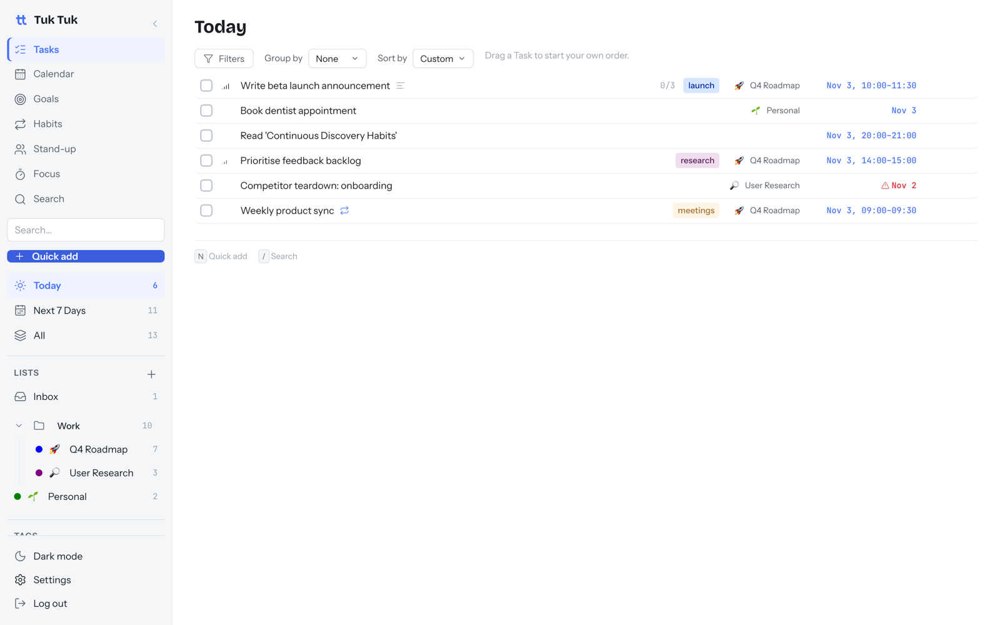
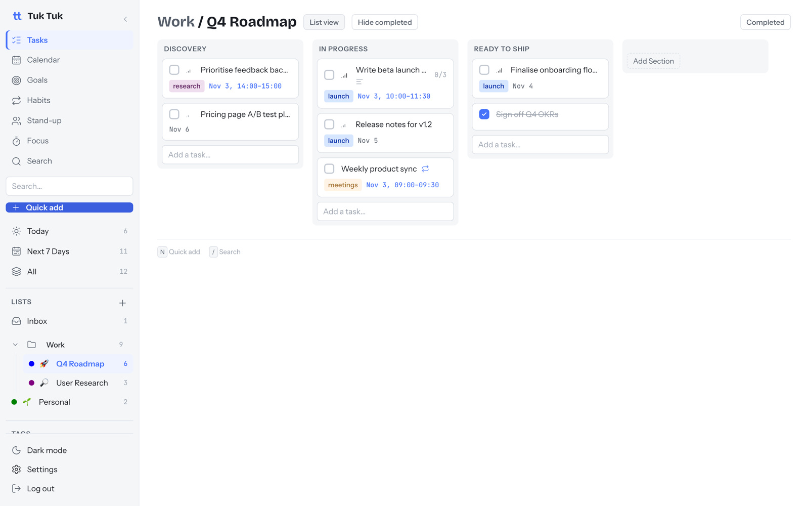
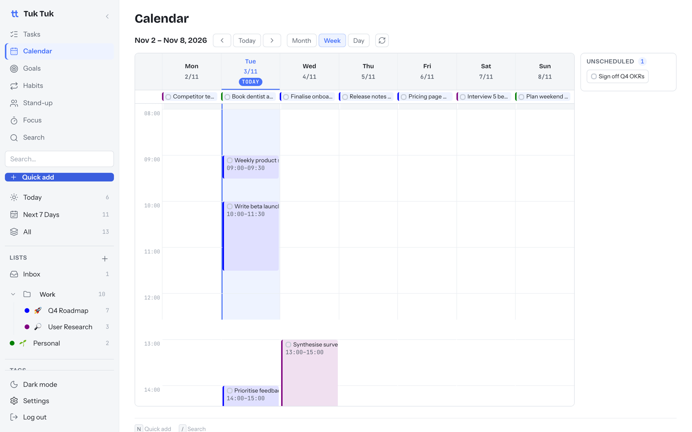
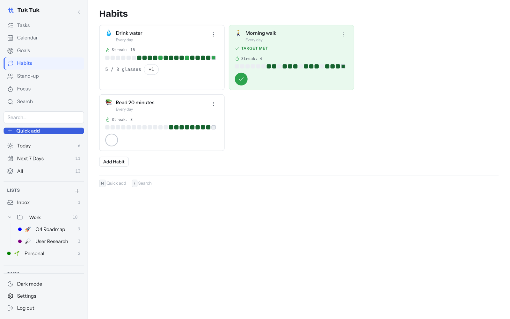
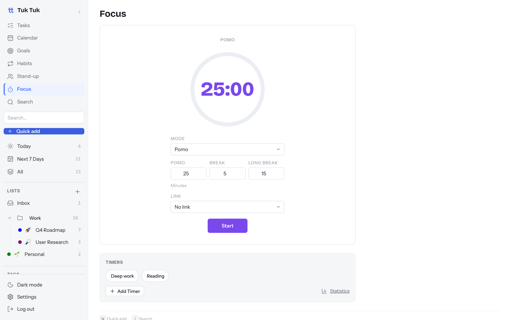
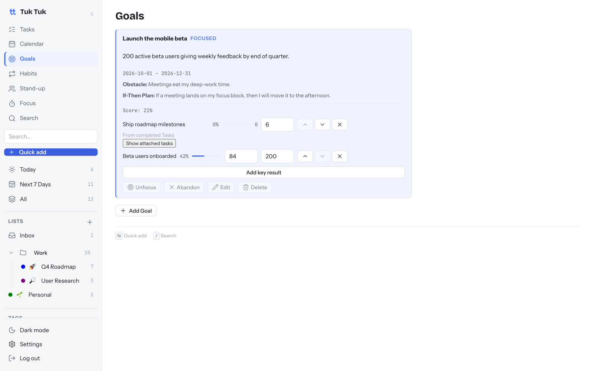

# 🛺 Tuk Tuk

**Your tasks, calendar, habits, focus timer and goals in one calm app that you own.**

Think Todoist + Google Calendar + a habit tracker + a Pomodoro timer + OKRs,
in a single self-hosted app. Your data stays on your machine.

[**Get started in ~10 min →**](docs/guide/getting-started.md) ·
[Features](#what-you-can-do) ·
[Docs](docs/README.md) ·
[FAQ](docs/guide/faq.md)

## Why Tuk Tuk

- **One app, not five.** Plan the day, block time, track habits, focus, and
  check progress on goals without switching tabs.
- **Your data, your server.** Runs on your laptop or home server. No account,
  no subscription, no tracking.
- **Capture in one line.** Type `Review metrics #launch !high @tomorrow @9am`
  and it's filed, tagged and scheduled.
- **AI is optional.** Assist suggests changes for you to accept. Voice applies
  bounded Task and Habit changes after spoken confirmation.
- **Works on your phone.** Add it to your home screen and use it like an app.

## What you can do

| | |
| --- | --- |
| **Plan your work.** Lists, folders, sections and a Kanban board. Smart views for Today and Next 7 Days. [Tasks →](docs/guide/features/tasks.md) |  |
| **See your week.** Drag tasks onto a Month, Week or Day calendar. Show your Google Calendar next to them. [Calendar →](docs/guide/features/calendar.md) |  |
| **Build habits.** Yes/no or count-based habits with streaks and history. [Habits →](docs/guide/features/habits.md) |  |
| **Focus.** Pomodoro or stopwatch, linked to a task, with weekly stats. [Focus →](docs/guide/features/focus.md) |  |
| **Hit your goals.** Quarterly goals with measurable key results that update from your tasks and habits. Plus a daily stand-up page. [Goals →](docs/guide/features/goals-and-standup.md) |  |

Also: [Quick-Add shortcuts](docs/guide/features/quick-add.md) ·
[AI Assist](docs/guide/features/ai-assist.md) ·
[Voice Assistant](docs/guide/features/voice.md) ([setup](docs/self-hosting/voice.md)) ·
[Terminal app](docs/guide/features/cli.md) ·
[MCP server](docs/guide/features/mcp.md)

## Get started

You need [Docker Desktop](https://www.docker.com/products/docker-desktop/).
Then follow the [Getting started guide](docs/guide/getting-started.md).
It takes about 10 minutes, and most of that is the first build.

## Documentation

| I want to… | Go to |
| --- | --- |
| Try it and learn the basics | [Getting started](docs/guide/getting-started.md) |
| Learn a feature | [Feature guides](docs/README.md#use-it) |
| Run it for real, upgrade, back up | [Self-hosting](docs/README.md#run-it) |
| Change the code | [CONTRIBUTING.md](CONTRIBUTING.md) |

## Project status

Tuk Tuk is built for **one person**: one password, no team accounts. It is
actively developed. See the [roadmap](docs/guide/roadmap.md) for what's
planned and the [changelog](CHANGELOG.md) for what shipped.

## License

MIT. See [`LICENSE`](LICENSE). Report security issues privately, as described in
[`SECURITY.md`](SECURITY.md).
