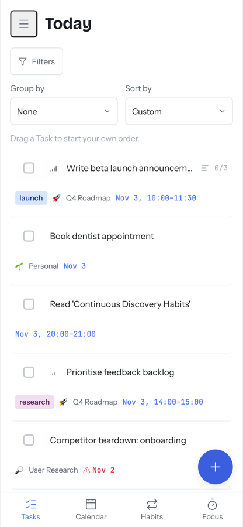

# FAQ

⏱ 4 min read

**Do this first:** scan the questions in bold and read only the ones you need.

## Basics

**What does it cost?**
Nothing. Tuk Tuk is free and open source (MIT licence). Optional cloud AI
providers charge you directly.

**Can my team use it?**
No. Tuk Tuk is built for one person. There's one password and no user accounts.
Everyone who should have their own data needs their own copy.

**Is there a hosted version I can sign up for?**
No. You run it yourself. [Getting started](getting-started.md) takes about 10 minutes.

**Does it work on my phone?**
Yes, in the browser. To get an app icon:
1. Open Tuk Tuk in Safari (iPhone) or Chrome (Android).
2. Tap **Share → Add to Home Screen** (iPhone) or **⋮ → Install app** (Android).

Your phone must be able to reach the computer running Tuk Tuk. See
[Install → Use it from other devices](../self-hosting/install.md#use-it-from-other-devices).

**Does it work offline?**
No. The page needs to reach the server.

## Privacy and data

**Where is my data?**
In a single database file on the computer running Tuk Tuk. Nothing is sent
anywhere unless you connect Google Calendar or a cloud AI provider.

**Does AI see my data?**
Only if you set up AI, and only the provider you choose. See
[AI Assist → Good to know](features/ai-assist.md#good-to-know).

**Does Tuk Tuk write to my Google Calendar?**
Never. It only reads.

**How do I back up?**
See [Upgrade and back up](../self-hosting/upgrade.md#back-up). It's one command.

## Troubleshooting

**I forgot my password.**
There's no reset email. Whoever runs the server can reset it. See
[Security → Forgotten password](../self-hosting/security.md#forgotten-password).

**Wrong passwords get slower to check.**
That's on purpose. Each failed attempt doubles the wait (up to 30 seconds) to
stop password guessing. The wait resets after a correct login.

**I got logged out.**
Sessions last 30 days after your last visit. Someone changing the password
also logs out every device.

**My reminders don't notify me.**
Not built yet. See the [roadmap](roadmap.md).

**Something else is broken.**
[Open an issue](https://github.com/Piwero/tuk-tuk/issues/new/choose). Say
what you did, what you expected and what happened.

## Next

→ [Roadmap](roadmap.md)
