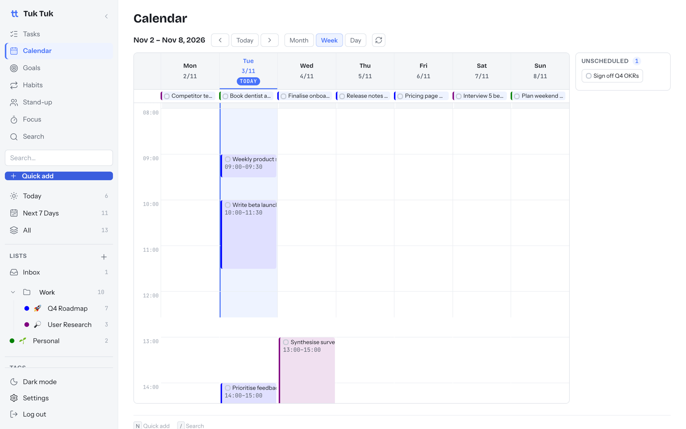

# Calendar and Google Calendar

⏱ 4 min read · Turn on/off: Settings → Features → Calendar

**Do this first:** open **Calendar → Week** and drag a task from the
**Unscheduled** panel onto a time slot.

## What it's for

See your tasks as time, not just a list. You'll quickly see if your day
is realistic, with your meetings shown beside your work.

## How to use it

1. Pick **Month**, **Week** or **Day** at the top.
2. Drag a task onto the grid to schedule it. Drag its bottom edge to change
   how long it takes.
3. Tasks without a date wait in the **Unscheduled** panel on the right.
4. Tick a task on the calendar to complete it.
5. The red line shows the current time.

## Connect Google Calendar

Your Google events appear next to your tasks. Tuk Tuk only **reads** them
and never changes your Google Calendar.

1. Create Google API credentials once (about 15 min). See
   [Install → Connect Google Calendar](../../self-hosting/install.md#optional-connect-google-calendar).
2. Paste the **Client ID** and **Client secret** into **Settings → Google Calendar**.
3. Connect your Google account and approve read-only access.
4. Choose which calendars to show and pick a colour for each.

You can connect several Google accounts, such as work and personal.

## Good to know

- **Click an event** to see its location, attendees and description.
  **Convert to task** turns it into a task you can tick off.
- **Declined events are hidden.** Invites you haven't answered still show.
- **Active hours:** **Settings → Active hours** makes your working hours
  taller and the rest of the day compact, so short tasks are easier to read.
- If Google access expires, a **Reconnect** banner appears. Your tasks are not affected.
- Events show in your own time zone. Tasks keep the time zone you scheduled them in.

## Next

→ [Habits](habits.md)
