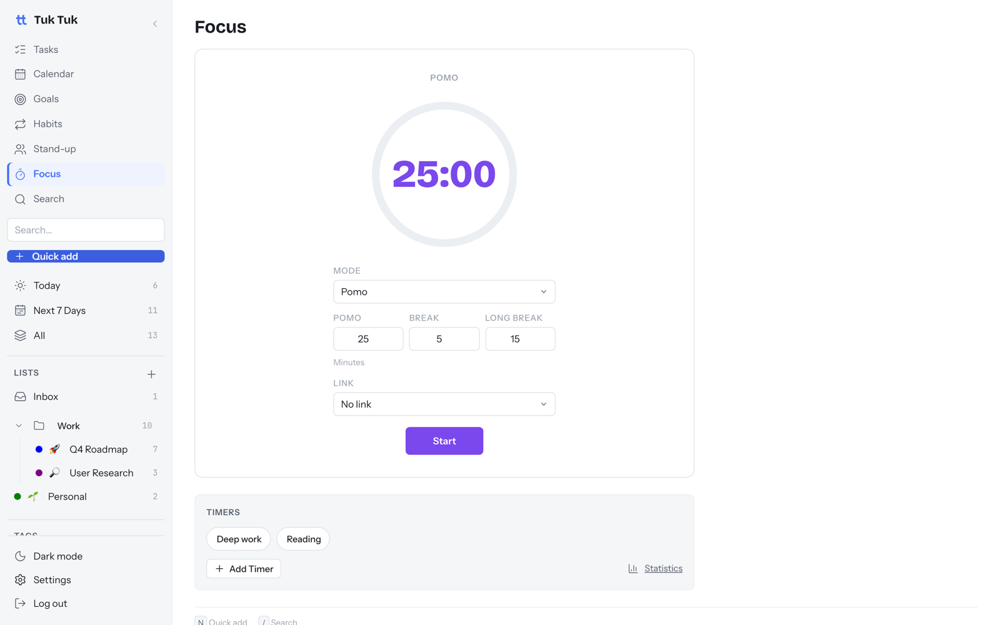
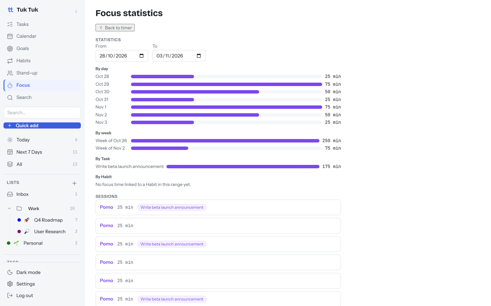

# Focus timer

⏱ 2 min read · Turn on/off: Settings → Features → Focus

**Do this first:** open **Focus**, choose a task under **Link**, and click **Start**.

## What it's for

Work in focused blocks and see where your time actually went.

## How to use it

1. Pick a **Mode**:
   - **Pomo:** counts down (default 25 min work, 5 min break, 15 min long break).
   - **Stopwatch:** counts up until you stop it.
2. Optionally **Link** a task or habit so the time counts toward it.
3. Click **Start**. A sound plays when a Pomo ends.
4. Save setups you reuse as **Timers**, such as "Deep work: 50 min" or "Reading".

## See your stats

Click **Statistics** for minutes per day, per week, per task and per habit,
plus a list of every session.

## Good to know

- Every finished session is saved, even if it isn't linked to anything.
- Durations are in minutes. Change them before you start.

## Next

→ [Goals and daily stand-up](goals-and-standup.md)
