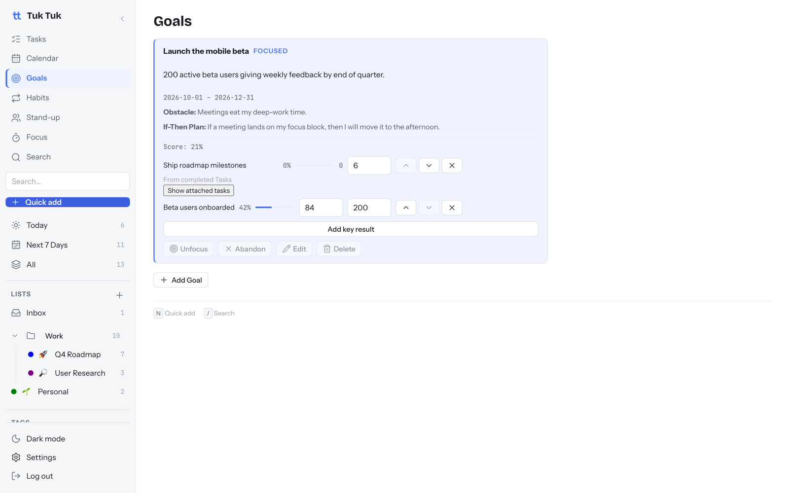
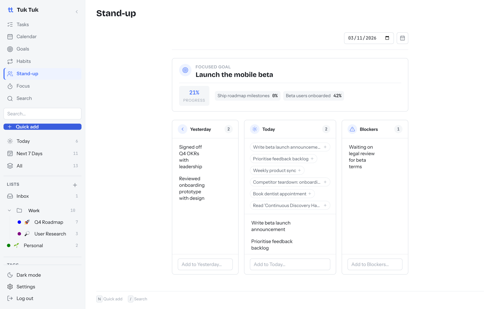

# Goals and daily stand-up

⏱ 5 min read · Turn on/off: Settings → Features → Goals / Stand-up

**Do this first:** open **Goals → Add Goal** and write one outcome you want by
the end of this quarter.

## What it's for

Connect daily tasks to the outcome you care about this quarter, and start
each day knowing what moves it forward.

Goals combine two proven methods:
- **OKRs:** a goal plus 1–3 numbers that prove you got there (key results).
- **WOOP:** naming what will get in your way and planning for it in advance.

## Set up a goal (5 min)

1. **Title:** what you want. "Launch the mobile beta".
2. **Description:** what success looks like. "200 active beta users by end of quarter".
3. **Obstacle:** what will likely stop you. "Meetings eat my deep-work time".
4. **If-Then plan:** "If a meeting lands on my focus block, then I will move it
   to the afternoon."
5. **Add key results.** Each one tracks a number in one of three ways:

| Tracking | Updates | Example |
| --- | --- | --- |
| **Manual** | You type the number | Beta users: 84 / 200 |
| **From a habit** | Adds up check-ins automatically | Workouts: 36 / 48 |
| **From tasks** | Counts completed tasks linked to it | Milestones shipped: 2 / 6 |

To link a task, open it and pick the key result under **Key Result**.

## Track it

- **Score** = average progress of the key results, from 0% to 100%.
- Goals run for the current quarter by default.
- **Focus** one goal to pin it to your stand-up.
- When the quarter ends, close the goal and write a short retro. You can also
  **Abandon** it. The score is frozen either way.

## Daily stand-up

A 2-minute morning check-in: **Yesterday**, **Today** and **Blockers**.

1. Open **Stand-up**. Your focused goal and its progress are at the top.
2. Click the suggested chips (tasks you finished or planned) to add them, or type your own.
3. Pick a past date to see earlier stand-ups.

Handy to copy into a team meeting or Slack.

## Good to know

- An empty goal shows no score (not 0%), so "not measured" never looks like "failed".
- Goals don't nest. Keep it to a few per quarter.

## Next

→ [AI Assist](ai-assist.md)
