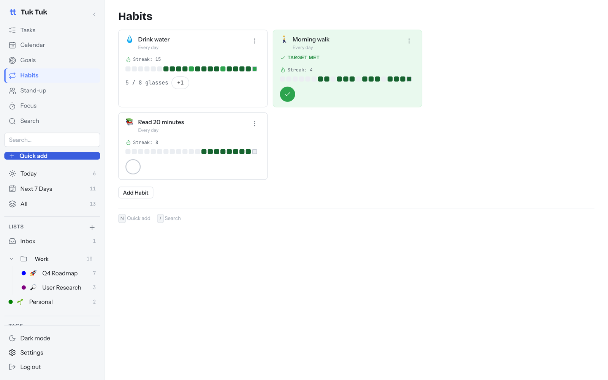

# Habits

⏱ 3 min read · Turn on/off: Settings → Features → Habits

**Do this first:** open **Habits → Add Habit**, name it "Morning walk", save,
then tap the circle.

## What it's for

Track things you want to do regularly, not just once. A streak and a
two-week history show your progress.

## Two kinds of habit

| Kind | Use for | You tap |
| --- | --- | --- |
| **Yes / no** | "Morning walk", "Meditate" | The circle, once |
| **Count** | "Drink water: 8 glasses" | **+1** until you reach the target |

## How to use it

1. Click **Add Habit**. Pick a name, an icon and the kind.
2. For a count habit, set the daily **target** and unit (for example 8 glasses).
3. Check in each day from the habit card.
4. Forgot yesterday? Fill it in from the history strip.

## Good to know

- **Streak** = days in a row without a miss.
- The card turns green with **Target met** once today is done.
- Archive a habit to hide it without losing its history.
- Link a habit to a [goal](goals-and-standup.md) and its check-ins count
  toward the goal automatically.
- Terminal users can check in with `tuk habits check <id>`. See [Terminal app](cli.md).

## Next

→ [Focus timer](focus.md)
