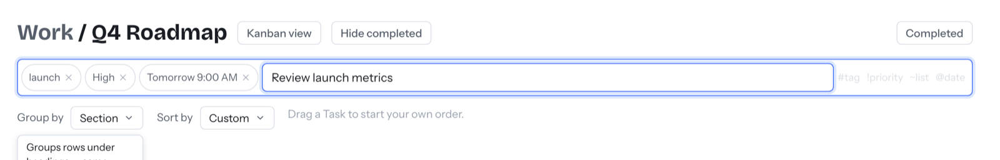
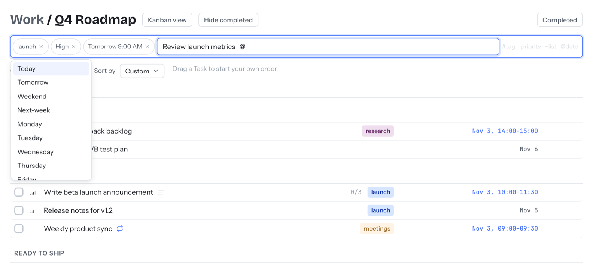

# Quick-Add and keyboard shortcuts

⏱ 3 min read · Always on

**Do this first:** press `N`, type `Call Sam !high @tomorrow @10am` and press Enter.

## What it's for

Add a task the moment you think of it without filling in a form. One line
sets its list, tags, priority and date.

## The four shortcuts

| Type | Sets | Examples |
| --- | --- | --- |
| `#` | Tag | `#launch`, `#home` |
| `!` | Priority | `!high`, `!medium`, `!low` |
| `~` | List | `~Groceries`, `~Q4 Roadmap` |
| `@` | Date and time | `@today`, `@tomorrow`, `@monday`, `@weekend`, `@next-week`, `@9am`, `@14:00` |

Each shortcut opens a suggestions menu as you type. Pick an option and it turns
into a chip. Click its **×** to remove it.

## How to use it

1. Press `N` anywhere, or click **Quick add** (on a phone, tap the blue **+**).
2. Type the task name, then add any shortcuts.
3. Press Enter.

## Good to know

- **Day and time combine.** `@tomorrow @9am` gives one chip: "Tomorrow 9:00 AM".
  A time on its own means today.
- **New tags and lists are only created on purpose.** If `#name` doesn't exist
  yet, the menu offers a **Create "name"** option. If you don't pick it, nothing new is created.
- **Free-form dates** ("next Friday at noon", "every 2 weeks") need
  [AI Assist](ai-assist.md). Without it, use the `@` words above.

## Keyboard shortcuts

| Key | Does |
| --- | --- |
| `N` | Quick add |
| `/` | Search |
| `Cmd + K` / `Ctrl + K` | Command palette: jump anywhere and run actions. The same `#` `!` `~` `@` shortcuts work here. |

## Next

→ [Calendar and Google Calendar](calendar.md)
