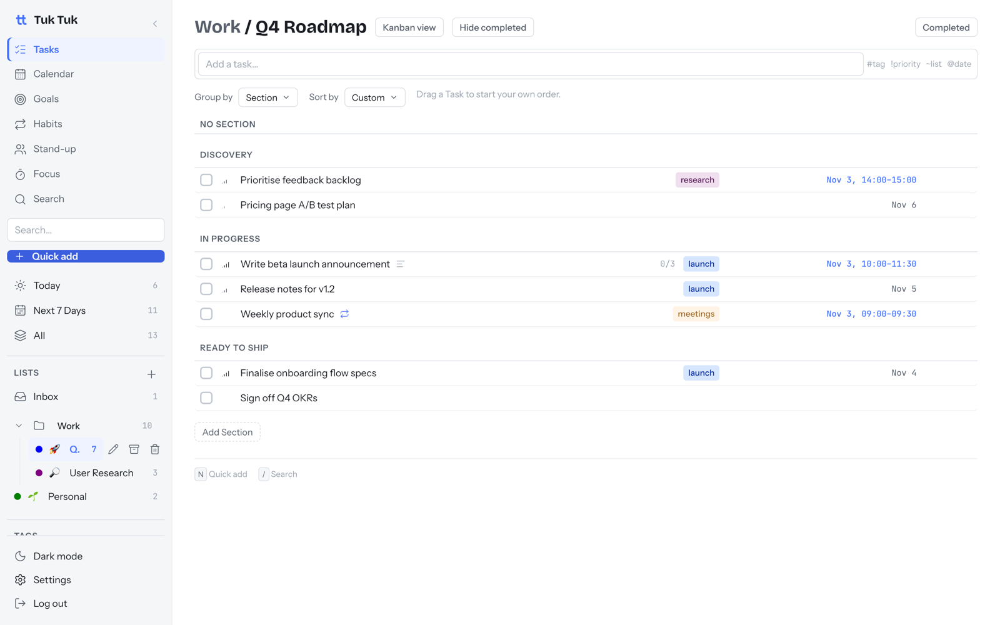
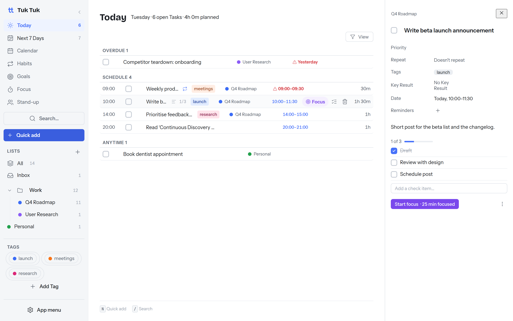
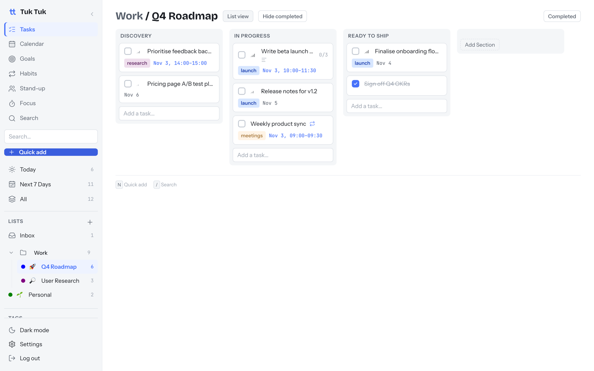

# Tasks, lists and boards

⏱ 4 min read · Always on

**Do this first:** click **+** next to **Lists** in the sidebar and create a
list called "This week".

## What it's for

Get everything out of your head and into one place, organised the way you
think. Tuk Tuk shows you what matters today.

## How it's organised

| Thing | What it is |
| --- | --- |
| **Task** | One thing to do. Can have dates, a priority, tags and a checklist. |
| **List** | A collection of tasks, such as "Q4 Roadmap" or "Groceries". |
| **Folder** | Groups lists in the sidebar, such as "Work" or "Home". Holds lists, not tasks. |
| **Section** | Splits a list into stages, such as "Discovery" or "In progress". Sections are also the board columns. |
| **Inbox** | Where tasks land when you don't pick a list. Always there. |

## Daily use

1. Open **Today** to see what's due or scheduled today. Overdue tasks are shown in red.
   Scheduled tasks show their start time and planned length. On a wide screen a
   day rail beside the list shows your Habits and Focus for today.
2. Tick the box to complete a task. Changed your mind? Untick it.
3. Click a task to open its details: priority, dates, reminders, repeat,
   tags, description and checklist. **Estimate** is how long you expect it to
   take, in minutes. It's optional, only used for planning, and a new
   **Planned work** block starts from it.
4. Drag tasks to reorder them, or drag between sections.
5. Open **Next 7 Days** on Monday to plan the week.

## Switch to a board

Open a list and click **Kanban view**. Each section becomes a column. Drag
cards between columns as work moves. Click **List view** to switch back.

## Find and filter

- **Smart Lists:** Today, Next 7 Days and All are built in. Each has a filter
  and can group or sort tasks.
- **Search:** press `/` and type. Results update as you type.
- **Tags:** click a tag in the sidebar to see every task that has it.
- **Many at once:** select several tasks to move, tag or complete them in one go.

## Good to know

- **Repeating tasks** move forward instead of closing. Complete "Weekly sync"
  and it moves to next week. Each finished one is recorded in history.
- **Reminders notify only while Tuk Tuk is open.** Add them ("30 minutes
  before"), then open **Settings → Reminder notifications** and pick
  **Enable on this device** on each device you want notified. A notification
  appears while a Tuk Tuk tab is open; click it to open the task. A tab in
  the background may still notify, late or not at all: that isn't supported
  or guaranteed. A closed browser or a locked device isn't supported, and a
  completed or deleted task never notifies. **Turn off on this device**
  stops only this device; **Turn off on all devices** stops them all.
- **Missed reminders** are listed at the top of Tuk Tuk when you come back:
  ones that came due after you turned notifications on but were never shown.
  Open the task, dismiss the entry, or snooze it.
- **Snooze a reminder** from the card it leaves in the app, or from the
  missed list: **Snooze 10 minutes** or **Snooze 1 hour**. It notifies once
  more then. The deadline stays unchanged, and completing the task cancels
  the snooze.
- **Quiet hours hold reminders.** Set them in **Settings → Quiet hours**
  (22:00–07:00 by default; a band can run past midnight). A reminder due
  during quiet hours waits and notifies once when they end, and stays listed
  in Tuk Tuk meanwhile. Quiet hours are not Active hours: Active hours only
  change the calendar.
- **Checklists** are lines inside a task, not separate tasks. Ticking the last
  one completes the task.
- **Priority** has four levels: None, Low, Medium and High.
- Renaming a tag renames it on every task.

## Next

→ [Quick-Add: capture a task in one line](quick-add.md)
