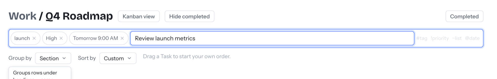

# Getting started

⏱ 10 min (about 5 of them waiting for the first build) · Needs: Docker Desktop

**Do this first:** install [Docker Desktop](https://www.docker.com/products/docker-desktop/)
and open it once so it's running.

## 1. Install (5–8 min)

Open a terminal (on a Mac: press `Cmd + Space`, type **Terminal**, press Enter).
Paste each line and press Enter:

1. Download Tuk Tuk:
   ```sh
   git clone https://github.com/Piwero/tuk-tuk.git && cd tuk-tuk
   ```
2. Create its secret key (one time only):
   ```sh
   echo "APP_MASTER_KEY=$(openssl rand -base64 32)" > .env
   ```
3. Start it:
   ```sh
   docker compose -f docker-compose.prod.yml up -d --build
   ```
   The first run builds the app, which takes about 5 minutes. Later starts take seconds.

> **Keep the `.env` file.** It holds the key that protects your saved Google
> and AI credentials. Lose it and you'll have to reconnect them.

## 2. Set your password (1 min)

1. Open **http://localhost:8080**.
2. Choose a password. This screen only appears once.

You're in. You stay logged in for 30 days on this browser.

## 3. Add your first task (1 min)

1. Click **Quick add** in the sidebar, or press `N`.
2. Type: `Try Tuk Tuk #trial !high @today`
3. Press Enter.

The task is added with a **trial** tag, **High** priority and today's date.
Open **Today** in the sidebar to see it.



## 4. Pick what you need (1 min)

Everything is on by default. Hide the parts you won't use:
**Settings → Features** and switch off Calendar, Goals, Habits, Focus, Assistant
or Stand-up. Your data stays saved and comes back when you switch a part on again.

## Stop and start

| To… | Run (from the `tuk-tuk` folder) |
| --- | --- |
| Stop | `docker compose -f docker-compose.prod.yml down` |
| Start again | `docker compose -f docker-compose.prod.yml up -d` |

Your data is kept when you stop. For more (phones, other computers, upgrades),
see [Install](../self-hosting/install.md).

## Next

→ [Tasks, lists and boards](features/tasks.md)
